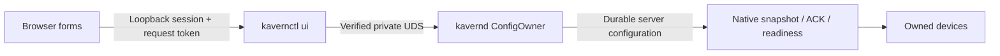

# ADR 0010: Minimal local WebUI over the private management socket

Status: design independently approved; W1 read-only implementation candidate awaits
independent review, 2026-10-13. W2 mutation UI remains paused.
Baseline: `078902bb6244a677ecbb9dcec61af6c4aa9a1579` (accepted L3).
This refines ADR 0008's local bridge proposal; it does not authorize real provisioning.

## Requirements and evidence

User requirements: server-owned business configuration; one user can own multiple
projects/devices; a small, understandable, extensible administration UI; device and
tunnel create/edit/enable/disable/status; honest save/synchronization/runtime errors;
safe bootstrap and credential delivery. Preserve `User -> Project -> Device -> Tunnel`,
current-session and target isolation, reviewed native lifecycle/resource bounds and
legacy boundaries. No enterprise RBAC, organizations, billing, SSO, hosted service,
upstream UI/source reuse, deployment or remote administrator exposure belongs here.

The frontend, browser-session constants, bridge limits and implementation slices
below are proposed decisions. They are not recovered user preferences. M1/M2 and
L1-L3 are accepted implementation evidence: ConfigOwner is the durable actor; the
private UDS and online CLI already implement mutation windows, CAS, receipts,
uncertainty/recovery and protected once-only issuance. Native agents automatically
synchronize server configuration and now use bounded renewable lifetimes. The UI
must adapt these contracts rather than create another owner or an HTTP CRUD database.
See `docs/ONLINE_ADMIN.md` for exact current DTOs. Its historical M2 lifetime section
is superseded by accepted ADR 0009/L3.

## Architecture and frontend choice

Use `kavernctl ui --socket PATH [--credential-dir PRIVATE_DIR]`: one explicitly
launched local process with Go standard-library HTTP, embedded HTML/CSS and small
plain JavaScript ES modules. The repository has Go 1.22, no frontend toolchain and
one reviewed management API; a framework/compiler/package manager would add a second
build/dependency lifecycle for a few forms. Keep modules for API/auth, inventory,
device editor, operation recovery and accessible common controls; native DOM/form
semantics supply the structure. Move to a framework only if concrete interaction
complexity later warrants its own review. No external scripts, fonts, CDN, analytics,
service worker or runtime asset downloads. All UI/code/artwork is original.

Keep bridge code and static assets in `cmd/kavernctl`/`cmd/kavernctl/ui_assets`; this
ADR records that asset directory choice without adding a Go package. Share a typed,
bounded UDS client and protected-file delivery primitives with the online CLI.
Do not shell out to CLI subcommands, parse their error strings, open state files,
start a second ConfigOwner, change native/legacy wire protocols or expose an arbitrary
URL/socket/file proxy. The daemon API remains private and authoritative.

The bridge verifies a harmless UDS health read through `config.DialAdmin` before
binding or issuing launch material. That preserves private path/inode checks and
same-UID `SO_PEERCRED` authentication on every connection. Its outgoing HTTP uses
fixed Host `kavern-admin`, no Origin/cookies/browser authorization/forwarded headers,
no environment proxy, no redirects, and only whitelisted M2 methods/paths/queries.
A browser can neither select another socket nor fetch an arbitrary local file.
Unsupported UDS platforms fail before publishing a browser endpoint.

## Product surface and layouts

A single local operator manages business ownership records; domain users are not
browser login identities. Header: Kavern, "Local administration", daemon health and
session/logout controls. User/project selectors filter the device inventory and
retain owning IDs. Offer minimal insert-only user/project creation for empty state;
editing ownership, reparenting, user/project deletion and tunnel moves stay deferred.

| View | Inputs and actions | Facts displayed |
| --- | --- | --- |
| Devices | Filter by user/project; create native device; open device | Name/ID, owning user/project, enabled state; status only when sampled |
| Device overview | Edit name; enable/disable; rotate native credential; delete with explicit cascade | Desired/applied revisions, connected/applying/ready/disabled/unavailable, actual/required carriers, renewal count, cleanup pending |
| Tunnels | Add/edit/delete TCP tunnel; enable/disable | Immutable ID/device, desired public listener, actual bound address, target on that device, listener/retry state |
| Bootstrap | Set server address, secret environment reference, CA path and optional TLS server name | Secret-free native bootstrap template and protected issuance delivery status/path |
| Recovery | Resolve an exact saved request; explicitly recover commit uncertainty | Redacted receipt, unknown/expired result, current desired state when available |

Native device creation/rotation is the first issuance UI. Existing legacy devices
remain visible and their server configuration can be edited, with explicit legacy
presence/listener facts. Legacy issuance/rotation stays in the existing CLI in this
first UI slice; never infer an offline device's credential kind from missing runtime
presence or invent a native applied revision for legacy clients.

Desktop: narrow ownership/filter column, device list, then selected-device details;
separate overview and tunnels tabs. Editing uses a contained labeled form with a
change summary and Save/Cancel. Mobile/narrow windows: selectors above a device-card
list; opening a device presents full-width tabs and single-column forms. No global
horizontal page scrolling; long IDs/addresses wrap and remain copyable. Responsive
layout is not permission to expose a desktop bridge to a remote phone.

Use semantic headings, labeled controls, field errors with an error summary/focus
link, keyboard navigation, visible focus, modal focus/return, live status announcements
and text labels in addition to color. Prefer 44-pixel action targets, 320-pixel reflow
and 200% zoom checks. Target WCAG AA text contrast; normal text needs 4.5:1 and large
text 3:1. [W3C contrast guidance](https://www.w3.org/WAI/WCAG22/Understanding/contrast-minimum.html)

Render user data using text nodes/form values, never HTML interpolation. Use an
original neutral surface with one accent and clearly labeled status badges. Core
empty/loading/offline/conflict/uncertain/bind-failure states receive the same visual
attention as the successful dashboard. No bulk destructive operation or dashboard
chart is needed for this gate.

## Configuration, synchronization and status contract

Fetch the complete device configuration before editing, even if only 50 tunnel rows
are rendered at once. Preserve owning IDs, disabled tunnels and current policy; a
visible subset is never the submitted whole configuration. Device/project/tunnel
identity cannot be edited or moved. Carrier policy is preserved and read-only in v0;
its supported server defaults are not a client override. Listener means an address
on the server; target means an address resolved by the selected device's agent.

Each initial Save is a deliberate new operation: obtain a fresh management window,
retain the original device revision, mint one operation ID and serialize the exact
complete request. Revisions and epochs stay canonical decimal strings; JavaScript
Number must not truncate uint64 values. Preserve that envelope before dispatch,
lock it while submitting and never mint a fresh ID/window for an unresolved retry.
The actor independently validates ownership, full candidate, global listener index,
native delivery capacity and all resource bounds. UI validation is assistance only.

| Observation | UI meaning |
| --- | --- |
| Definite `saved`, revision R | "Saved R"; subsequently sample application/binding/readiness |
| Native presence, applied behind desired | "Connected; applying R" |
| Server `Ready=true` at current desired/applied revision | "Ready"; show live carriers and bound addresses |
| `bind_failed`/`accept_failed` plus retry time | "Saved; listener failed; retry scheduled"; keep desired edit visible |
| No current session | "Agent disconnected"; no inferred authentication error |
| Disabled device/tunnel | "Disabled"; explain affected traffic stops |
| Cleanup pending | "Saved; closing affected work"; no rollback claim |
| Status/config request failed or changing revision | "Status unavailable/stale" with sample time; no cached green readiness |
| Legacy presence | "Legacy client connected"; native synchronization does not apply |

Use the server's ready observation; do not reconstruct authority from separate
cached values. If configuration/status revision differs, show changing/stale and
refresh. `target reachable` remains unknown until actual traffic evidence; readiness
is not a target-connected guarantee. Current DTOs provide listener state/retry,
health and safe mutation codes, not historical authentication/dial error messages.
Display those actual facts and "not reported" for unavailable details; no speculative
error history or observability framework is proposed.

Poll the selected device at most once/second, health every five seconds, only while
visible; cancel overlapping polls and avoid per-second fan-out across 128 devices.
Inventory is paginated by the existing 128-record cursors. Other devices remain
unaffected by scoped edits. Policy retirement, credential rotation and device
revocation retain existing reconnect/full-snapshot semantics; never replay TCP bytes.

## Conflict, response loss and uncertainty

A stale CAS/window rejects Save. Keep the draft, fetch current state and present the
changed fields with explicit Reload/Review and submit-again actions; no automatic
merge, revision bump or overwrite. A harmless unrelated management-epoch conflict
still requires resolving the rejected request before deliberately making a new one.

A network timeout/disconnect means outcome unconfirmed, not rollback. Keep the exact
original request (window, ID and content), look up that exact window/ID and use only
the existing digest-checked retained retry. Receipt lookup/replay is redacted and
cannot deliver another credential. Missing/evicted receipts remain unknown; inspect
current state and deliberately choose a new operation, never infer success from
matching content or automatically repeat rotation/delete. No-op keeps device revision
but advances management epoch as already implemented.

During `commit_uncertain`, clear ready displays, disable ordinary edits and state
claims, and show the existing redacted health plus an explicit Recover action.
Recovery validates the actual durable state and directory, then resolves the original
receipt when retained. It cannot recover a lost secret or revive retired runtime.

Propose at most four unresolved nonsecret request envelopes, at most 2 MiB total,
in per-tab sessionStorage, with no raw issuance values. Preflight storage before
mutation; if unavailable/full, require explicit export of the original recovery
request before dispatch. A daemon restart with the same bridge/browser origin can
resolve retained receipts. If the bridge also restarts to a new port, the old tab
can export its request offline for explicit import/lookup in the freshly authorized
UI. Imports validate bounded DTOs and are lookup/retry actions, never new mutation
submission. Export/import carries server configuration/operation metadata and must
be treated as private operator data. There is no bridge-side persistent operation
journal or unlimited receipt archive.

## Once-only credential delivery and bootstrap

Default decision: raw device credentials never enter the browser. Creation/rotation
requires an explicitly configured existing same-UID 0700 credential directory.
Without it the UI can read/edit existing configuration, but issuance actions explain
that the bridge must be relaunched with a protected destination. No browser-chosen
absolute output paths, file browsing/serving, credential download or clipboard secret
is provided in v0.

Before sending a fresh native issuance, derive a short unique fixed-format filename
within that directory and reuse M2's mode-0600, non-overwriting reserved file and
synced `delivery: unconfirmed` marker. On definite fresh Saved issuance, persist,
sync and verify the protected pathname/inode, then clear raw bytes and strip Issuance
from every browser response. Browser output contains only safe delivery state and
path. Replay/lookup never writes or reveals a new secret; file/path replacement or
lost response reports unconfirmed delivery. After resolving/recovering desired state,
explicit rotation to a new protected file is the only recovery for lost material.
Unconfirmed markers are preserved for inspection, not silently deleted or overwritten.

A secret-free bootstrap template contains only `server`, `device_id`, `secret_env`,
`ca_file` and optional `server_name`. Server address and trust references are explicit
operator inputs because the UDS health API does not supply deployable control/trust
bootstrap. Paths refer to the agent's host. The operator securely transfers/loads
issued material into the chosen environment; the UI neither executes shell commands
nor edits agent/system service files. No target map, listener list, carrier limits,
raw secret, MD5/native NPS option or insecure TLS flag enters this template.

## Loopback bridge and browser authentication

Bind only `tcp4` `127.0.0.1:0`, with no configurable remote listen address, public
proxy, IPv6/DNS alias or silent tunnel/SSH exposure. Require the exact assigned
`Host=127.0.0.1:PORT`, exact loopback peer, HTTP/1.1, fixed normalized paths/queries,
no Upgrade and no forwarded/proxy headers. Reject localhost, alternate IP spellings,
foreign Hosts and rebinding domains before assets/session/API handling. These are
bridge checks, not changes to native TLS or daemon UDS permissions.

Launch creates one 32-byte random one-use code in bridge memory, valid 120 seconds,
delivered through the explicit operator launch URL fragment. Printing that URL is
intentional short-lived operator delivery, not a diagnostic/access log; tests use
synthetic launch codes and never record real launch material. It is not a query,
cookie, access log, durable state or browser storage value. The page removes the
fragment with replaceState before authenticated work, posts the code once to the
strict same-origin bootstrap endpoint, and receives a fresh random session cookie
plus independent 32-byte request/CSRF token. Atomic consumption rejects replay and
concurrent exchange; no caller-selected session/fixation. One active browser session
per bridge is enough for v0; relaunch is the reauthorization path.

Use a per-instance cookie name and path under `/ui/INSTANCE/`, HttpOnly,
SameSite=Strict, no Domain and no persistent Max-Age. Loopback plain HTTP does not
reliably support Secure cookies across browsers, so do not claim Secure/__Host
protection for this proposed HTTP mode. It is confined to an explicitly launched
local bridge and has no remote HTTPS fallback. [MDN cookie transport guidance](https://developer.mozilla.org/en-US/docs/Web/HTTP/Guides/Cookies)

Cookies are not isolated by TCP port; path/name choices are hygiene, not an authority
boundary. Require both the cookie and its bound random request token on **all**
private API reads/mutations/logout/activity, not just writes. The token survives
same-tab reload in instance-keyed sessionStorage; no raw cookie value is copied to
browser-readable storage and no device credential enters the browser. No cookie-only endpoint can mint/recover that token. Cookie theft/fixation by
another loopback service cannot alone authorize requests; new authorization requires
the one-use launch code. Clear browser token on logout/401 and bridge session state
on expiry/restart. The OS owner and same-origin script integrity remain trusted;
this does not defend a compromised operator account/browser extension.
[RFC 6265 port isolation limits](https://www.rfc-editor.org/rfc/rfc6265#section-8.5),
[MDN per-tab storage behavior](https://developer.mozilla.org/en-US/docs/Web/API/Window/sessionStorage)

For every mutation/bootstrap/logout/activity require exactly the bridge Origin,
strict JSON and the custom request header where a session exists. For authenticated
GET require the custom token, and validate Origin if present. Reject foreign/null or
multiple Origins, unsupported content types/encodings and duplicate auth cookies.
No CORS headers or permissive OPTIONS handler. Fetch Metadata must reject cross-site
and same-site-but-cross-origin API requests; exact Host/Origin/token checks remain
mandatory when those headers are absent. Browser-forged cross-origin custom-header
requests fail preflight; nonbrowser clients still need both unpredictable values.
[OWASP CSRF guidance](https://cheatsheetseries.owasp.org/cheatsheets/Cross-Site_Request_Forgery_Prevention_Cheat_Sheet.html)

Propose ten-minute idle and one-hour absolute expiry, enforced on every private
request plus one bounded timer. Polling never extends idle lifetime. A throttled
same-origin authenticated activity POST from user interaction can extend idle, never
absolute expiry. Logout/expiry removes tokens and returns an expired-session screen.
Already dispatched bounded actor work still has a possibly durable result; expiration
is not cancellation/rollback evidence. Browser expiry/logout or bridge shutdown
never disables devices, stops the daemon/native agent or reinstates a TCP age limit;
existing tunnels continue under their own reviewed authority.

Serve original static assets with `default-src 'none'`, `script-src 'self'`,
`style-src 'self'`, `connect-src 'self'`, `img-src 'self'`, `base-uri 'none'`,
`object-src 'none'`, `form-action 'self'`, `frame-ancestors 'none'`; HTTP headers also
include no-store, nosniff, Referrer-Policy no-referrer, X-Frame-Options DENY and
Cross-Origin-Opener-Policy same-origin. No inline/eval scripts or HTML injection.
CSP is delivered as an HTTP header, including explicit frame-ancestors/form-action.
[MDN CSP directives](https://developer.mozilla.org/en-US/docs/Web/HTTP/Reference/Headers/Content-Security-Policy)

Bridge bounds: 32 accepted TCP connections, four concurrent UDS forwards with immediate
capacity rejection, 1 MiB request/response, 4 MiB retained forwarding bodies, 8 KiB
headers and bounded static assets. Five-second header/body, 12-second upstream,
15-second response and 30-second idle socket budgets are proposals; daemon bounds
remain unchanged. No generic mutation retry, unbounded queue/broadcast or event bus.
Shutdown closes idle/partial sockets, stops timers, joins forwards/results within a
bounded grace, clears ephemeral values and closes only its listener; it never removes
the daemon socket/state/credential files. No request body/code/cookie/token/credential
logging, telemetry or secret-valued screenshots.

## Authorization boundary

This design authorizes no live service launch or persistent credential creation.
After implementation GO, temporary synthetic fixtures/browser acceptance are the
coding scope. Real `admin_socket` enablement, runtime permissions changes, live bridge
launch, real device issuance/rotation, distributing credential/bootstrap files,
editing trust/TLS/master-key settings, public listener exposure, firewall/service
installation and any remote access require an explicit user action/request. A user's
later explicit command or UI Save supplies authorization for that concrete operation;
Codex should not add a second generic confirmation. Device disable/delete/rotation
and tunnel target/listener edits get clear scoped impact summaries before Save;
delete with tunnels also requires the actor's explicit cascade acknowledgement.
No action creates enterprise accounts, changes native security defaults, deploys or
publishes this bridge. Remote administration needs a separate approved architecture.

## Acceptance contract and bounded coding slices

First coding slice after design GO: CLI bridge, typed shared UDS client, embedded
original shell, one-use bootstrap/cookie/token/expiry, security headers/bounds and
read-only inventory/status. Test with temporary UDS peers and real browser behavior;
freeze files/diff/tests for independent review before mutation/issuance UI.

Second slice: accessible native device/tunnel forms, full CAS, protected issuance,
bootstrap template and exact-request recovery; no new business actor semantics.
Third slice: complete temporary-fixture browser/process and visual acceptance, then
independent review before any live provisioning. Every slice stops for its own GO.

| Acceptance | Required evidence |
| --- | --- |
| Browser boundary | Real browser cannot bootstrap cross-origin, replay code, use cookie alone, bypass CSRF/Host/Origin or read another loopback origin's token. Probe rebinding Host, Origin null/multiple, CORS/preflight, Fetch Metadata absence, fixation/duplicate cookies, refresh/idle/absolute expiry/logout and framing. No secret logs/storage. |
| Create and multi-device | Browser creates ownership records/native devices and protected delivery files. Launch two own-built native agents with synthetic env/trust; add tunnels in UI, automatic snapshot ACK/carriers/ready appear, target-confirmed TCP works for both. Config stored only on daemon. |
| Edit and isolation | Change one target/listener; affected stream/listener closes and new revision applies without manual agent config/restart. The other device/unchanged tunnel continues with byte receipts. Policy values preserved. |
| Disable and delete | UI disable stops active TCP and prevents auth/admission; enable resyncs. Tunnel deletion and explicit device cascade match durable state and tombstone/cleanup contracts. |
| Failure/recovery | Occupied listener remains Saved with bind_failed/retry and no old address serving; freeing it binds. Two-tab/CLI stale edits do not overwrite; response loss resolves original window/ID without double mutation/issuance. Inject uncertainty through test-only peers/filesystem fixtures, recover explicitly, and demonstrate expired receipt remains unknown. |
| Credential delivery | Raw secret absent from browser DOM/network/storage/download/console/screenshots; protected 0600 file in 0700 same-UID directory is verified. Lost response/file replacement never recovers/reissues through retry; explicit rotation retires old connection and enables fresh bootstrap. |
| Restart/reconnect | Restart temporary daemon, bridge remains bounded/retries read-only; saved config survives, ready clears then fresh auth/full synchronization/TCP returns. Restart bridge expires old authorization; imported original request resolves without replay at a new window. |
| Visual/accessibility | Real screenshots/DOM checks at 1440px and 390px, 320px reflow, 200% zoom and keyboard-only create/edit/error/recovery. Inspect loading, empty, applying, ready, disabled, bind-failure, stale and uncertain states; labels/focus/contrast and address wrapping. Never screenshot real credentials. |
| Process/resources | Own-built daemon/agent/CLI/bridge only, loopback target receipts, synthetic temporary CA/state/credentials; track every process/reader/socket and wait for terminal joins, state lock release and closed listeners. No external NPC binary, upstream source or live server. |
| Regression/review | Focused browser/security/actor cases, full offline/race/vet and legacy own-peer regression, frozen original asset/source manifest and output fingerprints. Existing performance evidence stays unchanged. Review before merge/commit/next slice. |

The design is reviewable now. Implementation, live browser/administrator services,
real provisioning and WebUI deployment remain paused until their respective approval.

## W1 authorized boundary and next-gate clarifications

Independent design review approved W1 only: the shared typed UDS client, bounded
loopback bridge/auth/security/resource cleanup, original responsive read-only shell
and inventory/status. There is no mutation, issuance, recovery or bootstrap editor
UI in W1. CLI mutation behavior remains available through its existing explicit
commands, not through this bridge. The normal test suite stays browser-install-free;
`ui_browser_acceptance` requires an explicitly supplied installed Chromium executable
and Node for synthetic headless verification, fails clearly when absent, and retains
browser sandbox protection. It adds no production clock/fault/test endpoint.

For W2, typed errors must distinguish definitive actor rejection from unconfirmed
outcome. Only a known precommit rejection code with its matching HTTP status can
certify rejection; transport, malformed/oversized response, status/code mismatch,
request expiry, response capacity and commit uncertainty remain unconfirmed. Keep
the exact original recovery envelope through browser auth expiry/logout; clear only
authentication state, not pending operation data. Expiry is never rollback evidence.

Offline native rotation must use explicit authoritative credential-kind metadata,
not current presence/protocol, an authentication attempt or a guessed kind. Propose
a small secret-free `credential_kinds` fact sourced from stored credential records,
including disabled/offline devices, as a separately reviewed W2 API/DTO extension.
It exposes no raw/derived material or ciphertext and does not call an enabled-only
auth resolver. Until that extension is accepted, W1 reports offline client protocol
as not reported and offers no rotation action; legacy issuance remains CLI-only.

### W1 R2 asynchronous observation corrections

Independent W1 review found two browser races. R2 treats health and selected-device
samples as separately versioned observations. Unavailable/uncertain health increments
authority generation, cancels/fences pending detail responses and clears readiness;
rendering readiness requires the current healthy observation. Health requests also
carry ordering tickets so an older response cannot replace a newer health fact.

Explicit device selection always supersedes a poll in progress, immediately updates
selection and starts the latest sample. Abort is an I/O optimization; request/selection
and health-generation checks reject late responses even when a delayed fetch wrapper
ignores abort. Ordinary polls share an existing same-device request rather than
starve it by continuously canceling it. Auth expiry and ownership-filter changes
invalidate pending details. Only an explicit healthy observation can restore sampling
following uncertainty. Permanent actual-browser regressions verify both races before
restoring their synthetic fixture for the remaining layout/security checks.
